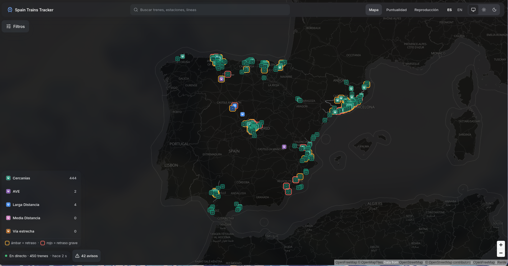
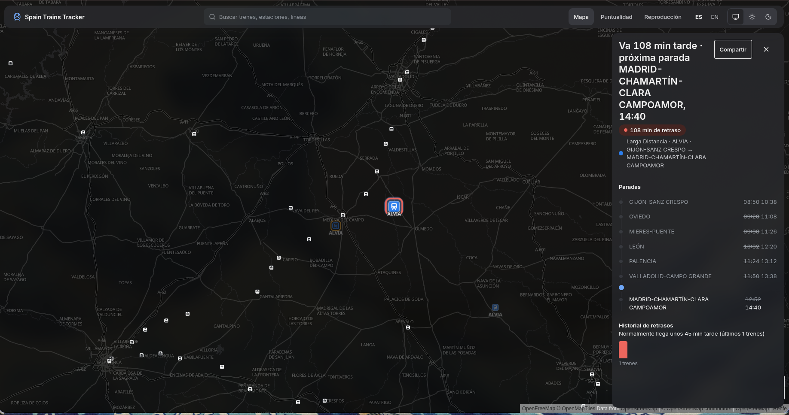
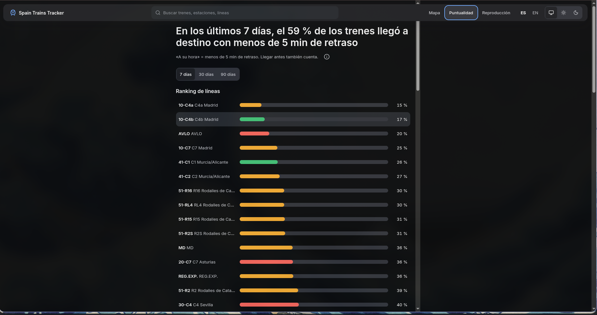
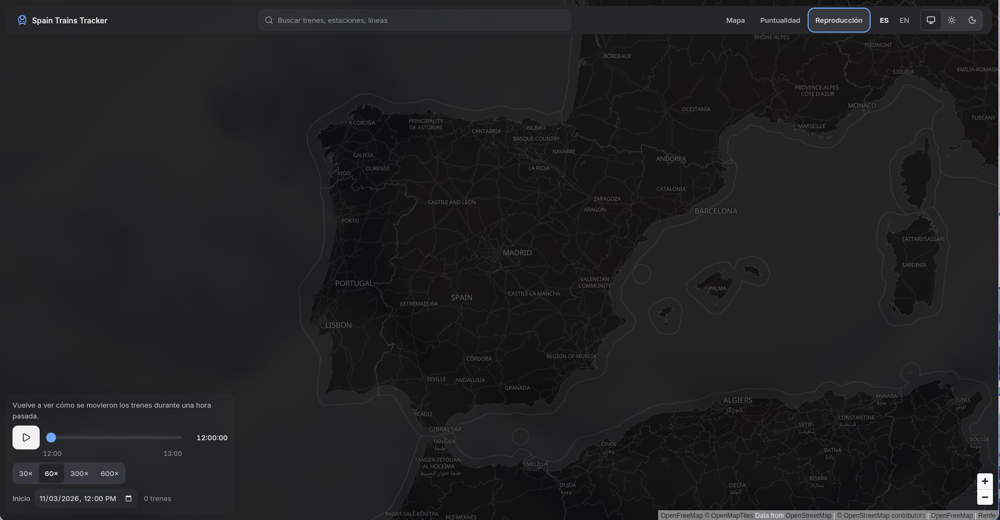

# Spain Trains Tracker

Live and historical view of Renfe trains across Spain, built from Renfe's open data feeds.
See [`GLOSSARY.md`](./GLOSSARY.md) for domain language and [`docs/adr/`](./docs/adr) for architecture decisions.

## Preview

<table>
  <tr>
    <td width="50%">
      <a href="./docs/screenshots/live-map.png"></a>
      <p align="center"><b>Live map</b>: every running train, coloured by service, with delays highlighted</p>
    </td>
    <td width="50%">
      <a href="./docs/screenshots/train-detail.png"></a>
      <p align="center"><b>Train detail</b>: current delay, next stop, every stop's times and delay history</p>
    </td>
  </tr>
  <tr>
    <td width="50%">
      <a href="./docs/screenshots/punctuality.png"></a>
      <p align="center"><b>Punctuality</b>: on-time share over 7, 30 or 90 days, and a ranking of lines</p>
    </td>
    <td width="50%">
      <a href="./docs/screenshots/replay.png"></a>
      <p align="center"><b>Replay</b>: watch how trains moved during any past hour, at up to 600× speed</p>
    </td>
  </tr>
</table>

## Getting started

### Prerequisites

- **Node.js 24**: the version is pinned in [`.nvmrc`](./.nvmrc), so run `nvm use` (or `fnm use`).
- **pnpm**: the version is pinned in `package.json` (`packageManager`). Run `corepack enable` and it is picked up automatically.
- **Docker**: needed to run the local Postgres + TimescaleDB + PostGIS database.

### Install and verify

```sh
pnpm install
pnpm turbo lint typecheck test
```

### Local database

Copy `.env.example` to `.env`, then `pnpm db:up`. This starts Postgres 17 with PostGIS and TimescaleDB on `localhost:5432` (bound to the loopback interface only) (`DATABASE_URL` is in `.env.example`). Extensions are enabled by [`docker/initdb/`](./docker/initdb) on first start. To wipe the data, run `docker compose down -v`.

### Workspace layout

```
apps/       # deployable apps (web, api)
packages/   # shared libraries (@stt/contracts, ...)
```

### Common scripts

| Command          | What it does                                         |
| ---------------- | ---------------------------------------------------- |
| `pnpm build`     | Build every workspace via Turborepo                  |
| `pnpm dev`       | Run every workspace's `dev` task                     |
| `pnpm lint`      | Biome lint + format check over the whole repo        |
| `pnpm lint:fix`  | Apply Biome's safe fixes and formatting              |
| `pnpm typecheck` | `tsc --noEmit` in every workspace                    |
| `pnpm test`      | Vitest in every workspace (or `pnpm vitest` at root) |
| `pnpm db:up`     | Start the local database and wait until healthy     |
| `pnpm db:down`   | Stop the local database (data volume is kept)        |
| `pnpm dev:all`   | DB + migrations + API (:3002) + worker + web (:3000) |
| `pnpm --filter web e2e:live` | Playwright e2e on the real stack, no mocks. Needs `pnpm dev:all` running (`WEB_PORT` overrides :3000); not part of `pnpm test` |
| `pnpm --filter api db:migrate` | Apply Drizzle migrations to `DATABASE_URL` |
| `pnpm --filter api db:generate` | Generate a migration from schema changes (`db:generate:custom` for raw SQL: hypertables, PostGIS) |

Drizzle has no down migrations. To roll back a migration, run its script in `apps/api/drizzle/rollback/` by hand and delete its row from `drizzle.__drizzle_migrations`.

### Adding a workspace

Each workspace under `apps/` or `packages/` should:

- extend `../../tsconfig.base.json` from its own `tsconfig.json`,
- define a `vitest.config.ts` using `defineProject` (the root config picks it up),
- expose `lint`, `typecheck` and `test` scripts so Turborepo can run them.
